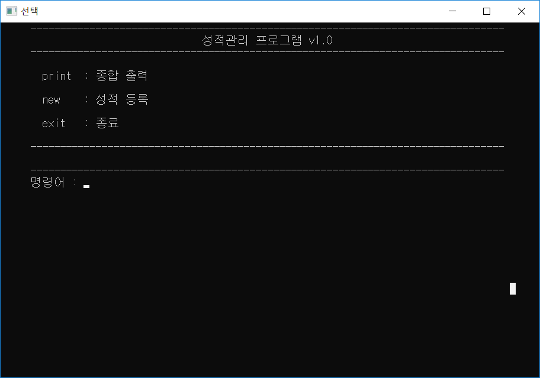

# Class Manager

학생의 학번, 이름, 국어와 영어 성적을 등록하고, 고른 항목 순으로 정렬해 반 평균, 표준편차와 함께 출력하는 C 콘솔 프로그램이다. 메뉴 출력, 입력 검사, 문자열 검사를 파일 단위 모듈로 나눠 만들었다. 학교 과제다.

<p>
  
</p>


## 사용 방법

Releases에서 받아 실행하면 된다. `명령어 :` 뒤에 명령어를 입력하고 Enter 를 누른다.

| 화면 | 명령어 | 동작 |
|---|---|---|
| 메인 | `print` | 종합 출력 화면으로 간다 |
| 메인 | `new` | 성적 등록 화면으로 간다 |
| 메인 | `exit` | 종료 |
| 성적 등록 | `new` | 학생 한 명의 학번, 이름, 국어 성적, 영어 성적을 차례로 입력한다 |
| 종합 출력 | `id`, `name`, `korean`, `english` | 학번, 이름, 국어 성적, 영어 성적 순으로 정렬해 출력한다 |
| 성적 등록, 종합 출력 | `back` | 메인 화면으로 돌아간다 |

| 항목 | 조건 |
|---|---|
| 학번 | 100 부터 999 까지의 정수. 이미 등록된 학번과 겹치지 않아야 한다 |
| 이름 | 영문 소문자 1 에서 5글자. 첫 글자는 대문자로 바꿔 저장한다 |
| 국어, 영어 성적 | 0 부터 100 까지의 정수 |

조건에 맞지 않으면 이유를 알려 주고 다시 입력받는다. 학생은 256명까지 등록할 수 있고, 등록한 성적은 프로그램이 켜져 있는 동안 메모리에 둔다. 종합 출력에서 정렬 항목을 고르면 정렬 방향을 묻는데, `오름차순` 이나 `내림차순` 을 한글로 입력한다. 표 아래에 국어와 영어의 평균, 표준편차가 함께 나온다.


## 구현 원리

**화면은 줄 버퍼에 쌓아 한 번에 찍는다.** `MenuManager` 는 128줄짜리 문자 배열을 줄 목록으로 쓰고, 첫 글자가 널인 줄을 목록의 끝으로 본다. 화면이 바뀔 때마다 `menuClear` 로 비우고 `menuAdd` 로 줄을 쌓은 뒤 `menuPrint` 가 왼쪽 여백을 붙여 출력한다. 메인 루프는 현재 화면 번호(`RoomMain`, `RoomPrint`, `RoomNewStudent`)에 따라 명령어를 해석하고, 번호가 `none` 이 되면 `changeMenu` 가 `false` 를 돌려 끝난다.

```c
while (changeMenu(currentMenuIndex, currentMenu))
{
	menuGetCommand(command);
	switch (currentMenuIndex)
	{
		...
	}
	system("cls");
}
```

**입력 검사는 두 층으로 나눴다.** `StringExt` 는 문자열이 숫자로만(맨 앞의 부호는 허용), 대문자로만, 소문자로만 되어 있는지 검사한다. `InputExt` 는 `gets_s` 로 한 줄을 받아 그 검사를 통과할 때까지 오류 문구를 찍고 다시 받는다. 학번과 성적의 범위, 이름 길이는 그 위의 `Main.c` 에서 한 번 더 검사한다. C 에 없는 `true`, `false`, `null` 과 빈 값을 뜻하는 `none` 은 `Boolean.h` 와 `Null.h` 에 매크로로 정의했다.

**정렬은 네 배열을 함께 바꾼다.** 학생 정보는 학번, 이름, 국어, 영어 배열 네 개에 같은 순번으로 들어 있다. 정렬 기준 배열을 포인터로 고르고(이름은 `strcmp` 로 비교), i 번째 원소를 그 뒤의 원소들과 차례로 비교해 순서가 맞지 않으면 네 배열의 두 칸을 모두 맞바꾼다. 정수는 XOR 교환으로 바꾼다.

**표준편차는 거듭제곱 함수를 직접 짜서 구한다.** 재귀로 만든 `power` 로 편차의 제곱을 더하고, 학생 수로 나눈 뒤 `sqrt` 로 제곱근을 구한다.


## 파일

| 경로 | 내용 |
|---|---|
| `source/ClassManager.sln` | Visual Studio 2015 솔루션 |
| `source/ClassManager/Main.c` | 메인 루프, 화면 구성, 항목 입력, 정렬, 평균과 표준편차 |
| `source/ClassManager/MenuManager.c` | 화면 줄 버퍼 |
| `source/ClassManager/InputExt.c` | 검사를 통과할 때까지 다시 받는 입력 함수 |
| `source/ClassManager/StringExt.c` | 숫자, 대문자, 소문자 검사 |
| `source/ClassManager/Boolean.h`, `source/ClassManager/Null.h` | `true`, `false`, `null`, `none` 정의 |
| `docs/screenshots/` | 스크린샷 |
| Releases | 실행 파일 |


## 라이선스

zlib 라이선스다. 자세한 내용은 [LICENSE](LICENSE) 에 있다.
